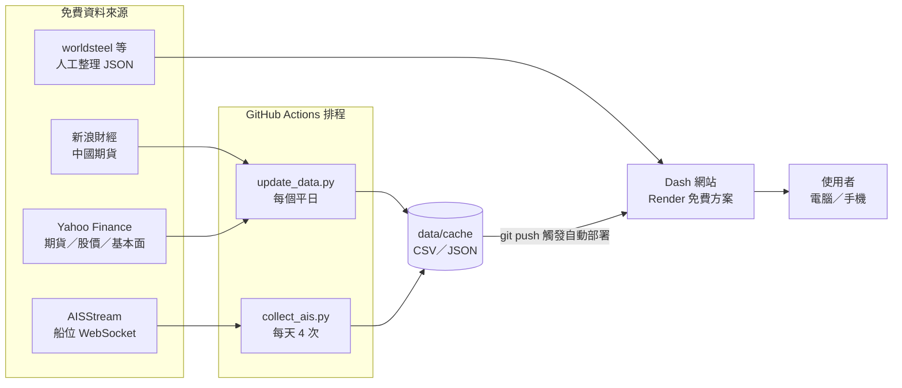
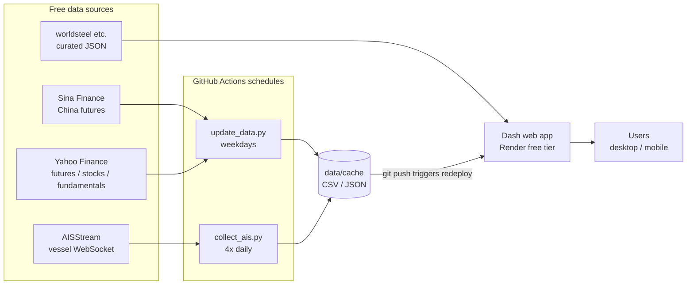

# Global Iron

**[繁體中文](#繁體中文) · [English](#english)**

🌐 Live site / 線上網站: **https://global-iron.onrender.com**

---

## 繁體中文

一個免費、中英雙語的全球鋼鐵市場觀測網站：一眼掌握鋼價、全球鋼廠、貿易流向與航運風險。

**目標使用者：**全球股票投資人、地緣政治研究者、航運與海上保險從業者。

### 功能

| 頁面 | 內容 | 主要回答的問題 |
|---|---|---|
| 市場總覽 `/` | **本週重點**自動摘要、6 個指標卡（最新價、週／月／年漲跌、10 年分位）、市場狀態判斷、高爐利潤代理、美中熱軋價差、原料走勢＋政策事件標註 | 鋼市現在處於景氣循環的哪裡？ |
| 月度數據 `/monthly` | 中國每月鋼材出口、worldsteel 每月全球產量（中國 vs 其他、前 10 大國年增率）、中鋼月盤調整與累計 | 供需面最近有沒有變化？ |
| 全球地圖 `/map` | 49 家鋼廠與礦商（45 家鋼廠、4 家鐵礦商）（泡泡 = 產量、顏色 = 製程）、各國產量、鐵礦／煤／鋼材航線、11 個咽喉要道、港口、2024 貿易流、AIS 船位、中鋼運通船隊 | 誰在哪裡生產？貨怎麼運？風險在哪？ |
| 公司分析 `/companies` | 公司檔案、同業相對分數（體質／價值／動能）、股價比較、**季度利潤率趨勢**、可排序比較表。支援 `?c=posco` 直接連結 | 這家公司跟同業比起來狀況如何？ |
| 情境模擬 `/scenario` | 調整熱軋／鐵礦／焦炭價格，看每噸利潤瀑布圖、年度影響、敏感度 | 原料漲 10%，鋼廠會少賺多少？ |
| 貿易與風險 `/risk` | 區域貿易矩陣、淨出口國、鐵礦供需、各國產量、咽喉要道風險表（附官方即時公告連結）、政策時間軸 | 誰依賴誰？哪些航道有風險？ |
| 資料與方法 `/about` | 所有資料來源、計算方法、已知限制、最近更新時間 | 這些數字可以信嗎？ |

所有頁面都可中英切換（選擇會記在瀏覽器），電腦與手機都有調整過版面。

### 資料來源（全部免費）

| 資料 | 來源 | 更新頻率 |
|---|---|---|
| 中國熱軋、螺紋鋼、鐵礦、焦炭、焦煤期貨 | 上期所／大商所主力連續合約（新浪財經公開介面） | 每個平日 |
| 美國中西部熱軋卷期貨 | CME `HRC=F`（Yahoo Finance） | 每個平日 |
| 鐵礦 62% 到岸中國 | SGX/CME `TIO=F`（Yahoo Finance） | 每個平日 |
| 乾散貨運價代理 | BDRY ETF（Yahoo Finance） | 每個平日 |
| 匯率、布蘭特原油 | Yahoo Finance | 每個平日 |
| 38 家上市公司股價與基本面 | Yahoo Finance（`yfinance`） | 每個平日 |
| 各公司季報損益 | Yahoo Finance（`yfinance`） | 每個平日 |
| 每月全球粗鋼產量 | worldsteel 每月新聞稿（自動抓取） | 每月 |
| 中國每月成品鋼材出口 | 海關總署數字，經產業媒體轉載（`data/static/china_steel_exports.json`） | 每月手動 |
| 中鋼月盤調整 | 中鋼盤價公告的媒體報導（`data/static/csc_price_changes.json`） | 每月手動 |
| 公司與各國粗鋼產量、鋼材與鐵礦貿易 | worldsteel《World Steel in Figures 2025》（2024 資料） | 每年 |
| 船舶位置（AIS） | AISStream.io（免費岸基 AIS） | 每天 4 次 |
| 中鋼運通船隊名單 | 中鋼運通官網船隊頁 | 手動 |
| 咽喉要道、航線、港口、政策事件 | 人工整理（`data/static/*.json`），事件日期已對照法規與新聞查核 | 手動 |

**已知限制：**沒有 Platts／Argus 現貨價、歐洲熱軋、廢鋼（需付費授權）；免費 AIS 在歐洲、日本涵蓋好，中國、台灣、澳洲稀疏；未上市集團與受制裁的俄、伊鋼廠沒有財務資料。

### 技術架構



| 層 | 技術 | 用途 |
|---|---|---|
| 介面 | **Dash**（Python）＋ **Plotly** | 頁面、互動控制項、圖表與世界地圖 |
| 分析 | **pandas** | 利差、分位數、同業評分、情境模型（`core/analytics.py`） |
| 資料抓取 | `requests`、`yfinance`、`websockets` | 期貨、股價、AIS |
| 排程 | **GitHub Actions** | 每日／每 6 小時抓資料並 commit 回 repo |
| 部署 | **Render**（免費 Web Service）＋ `gunicorn` | 偵測到 push 就自動重新部署 |
| 效能 | 依資料版本快取、gzip 壓縮、長區間降採樣、啟動預熱 | 免費主機 CPU 弱，靠快取讓頁面秒開 |

### 專案結構

```
app.py                  入口：外框、路由、語言切換、啟動預熱
core/                   與介面無關的邏輯（未來可直接給 FastAPI 重用）
  config.py             路徑、價格序列、色票
  fetch.py              抓資料（只有更新腳本會呼叫）
  data.py               讀取 static／cache 資料
  analytics.py          利差、分位數、同業評分、情境模型
  cache.py              計算結果快取（資料更新自動失效）
  i18n.py               中英文字串
pages/                  每頁一個模組：layout(lang) + register(app)
core/highlights.py      「本週重點」規則式摘要
scripts/
  update_data.py        更新價格、股價、基本面
  collect_ais.py        AIS 快照與船隊 MMSI 探索
data/static/            人工整理資料（直接編輯 JSON，不用改程式）
data/cache/             自動抓的資料（排程 commit）
.github/workflows/      update-data.yml（市場）、update-ais.yml（船位）
```

### 本機執行

```bash
python3 -m venv .venv
.venv/bin/pip install -r requirements.txt
.venv/bin/python scripts/update_data.py      # 抓資料（約 2–4 分鐘）
.venv/bin/python app.py                      # 開 http://127.0.0.1:8050
```

AIS（選用）：到 https://aisstream.io 用 GitHub 登入取得免費金鑰，`export AISSTREAM_API_KEY=...` 後執行 `.venv/bin/python scripts/collect_ais.py --seconds 300`。線上排程則把金鑰存成 GitHub Secret `AISSTREAM_API_KEY`。

### 每月手動更新（約 5 分鐘）

1. 海關約每月 7–10 日公布上月出口：在 `data/static/china_steel_exports.json` 的 `monthly` 加一筆，並更新 `ytd`
2. 中鋼約每月中公布下月盤價：在 `data/static/csc_price_changes.json` 的 `changes` 加一筆
3. commit 並 push，Render 會自動更新網站

### 部署

Render → New → Blueprint → 選這個 repo，會依 `render.yaml` 自動建立免費 Web Service。免費方案閒置 15 分鐘會休眠，喚醒約需 50 秒。

### 免責聲明

僅供參考，非投資建議。免費資料可能延遲或有誤，決策前請查核原始資料。

---

## English

A free, bilingual (Traditional Chinese / English) monitor of the global steel market: prices, producers, trade flows and shipping risk at a glance.

**Built for:** global equity investors, geopolitical researchers, and shipping / marine-insurance professionals.

### Features

| Page | What it shows | Question it answers |
|---|---|---|
| Market `/` | **This week at a glance** auto-summary, 6 KPI tiles (latest price, 1W/1M/1Y change, 10-year percentile), market-regime call, blast-furnace margin proxy, US vs China HRC gap, raw-material trends with policy-event overlay | Where is steel in the cycle right now? |
| Monthly `/monthly` | China's monthly steel exports, worldsteel monthly production (China vs rest of world, top-10 YoY), China Steel list-price changes and cumulative | Has supply / demand shifted lately? |
| Global Map `/map` | 49 companies (45 steelmakers, 4 iron-ore miners) (bubble = output, colour = process route), country output, ore/coal/steel sea lanes, 11 chokepoints, ports, 2024 trade flows, AIS vessels, China Steel Express fleet | Who produces where, how does it move, where is the risk? |
| Companies `/companies` | Company profile, peer-relative scores (health / value / momentum), share-price comparison, **quarterly margin trend**, sortable peer table. Deep links like `?c=posco` | How is this company doing versus peers? |
| Scenario `/scenario` | Shock HRC / ore / coke prices; per-tonne margin waterfall, annual impact, sensitivities | If ore rises 10%, how much margin does a mill lose? |
| Trade & Risk `/risk` | Regional trade matrix, net exporters, iron-ore supply/demand, country output, chokepoint register (with official live-advisory links), policy timeline | Who depends on whom, which lanes are exposed? |
| Data & Method `/about` | Every source, method, known limit and last refresh time | Can I trust these numbers? |

Every page switches language (remembered in the browser) and is laid out for both desktop and mobile.

### Data sources (all free)

| Data | Source | Refresh |
|---|---|---|
| China HRC, rebar, iron ore, coke, coking coal futures | SHFE / DCE main continuous contracts (Sina Finance public endpoint) | Weekdays |
| US Midwest HRC futures | CME `HRC=F` (Yahoo Finance) | Weekdays |
| Iron ore 62% Fe CFR China | SGX/CME `TIO=F` (Yahoo Finance) | Weekdays |
| Dry-bulk freight proxy | BDRY ETF (Yahoo Finance) | Weekdays |
| FX, Brent crude | Yahoo Finance | Weekdays |
| Share prices and fundamentals for 38 listed companies | Yahoo Finance (`yfinance`) | Weekdays |
| Quarterly income statements | Yahoo Finance (`yfinance`) | Weekdays |
| Monthly global crude steel production | worldsteel monthly press releases (scraped) | Monthly |
| China's monthly finished-steel exports | GACC figures via trade press (`data/static/china_steel_exports.json`) | Monthly, manual |
| China Steel list-price changes | CSC announcements via Taiwanese media (`data/static/csc_price_changes.json`) | Monthly, manual |
| Company and country crude-steel output, steel and ore trade | worldsteel *World Steel in Figures 2025* (2024 data) | Yearly |
| Vessel positions (AIS) | AISStream.io (free terrestrial AIS) | 4× daily |
| China Steel Express fleet list | China Steel Express website fleet page | Manual |
| Chokepoints, sea lanes, ports, policy events | Curated in `data/static/*.json`; event dates checked against legal and press sources | Manual |

**Known limits:** no Platts / Argus physical prices, European HRC or scrap (licensed data); free AIS covers Europe and Japan well but China, Taiwan and Australia sparsely; no financials for unlisted groups or sanctioned Russian / Iranian mills.

### Architecture



| Layer | Technology | Role |
|---|---|---|
| UI | **Dash** (Python) + **Plotly** | Pages, controls, charts and world map |
| Analytics | **pandas** | Spreads, percentiles, peer scores, scenario model (`core/analytics.py`) |
| Ingestion | `requests`, `yfinance`, `websockets` | Futures, equities, AIS |
| Scheduling | **GitHub Actions** | Fetch data daily / every 6 h and commit it back to the repo |
| Hosting | **Render** (free web service) + `gunicorn` | Auto-redeploy on every push |
| Performance | Data-versioned caching, gzip, downsampling of long ranges, warm-up at boot | Fast pages on a low-CPU free host |

### Project layout

```
app.py                  Entry point: shell, routing, language toggle, warm-up
core/                   UI-independent logic (reusable from a future FastAPI backend)
  config.py             Paths, price series, palette
  fetch.py              Data fetchers (used only by the update scripts)
  data.py               Read static / cached data
  analytics.py          Spreads, percentiles, peer scoring, scenario model
  cache.py              Result cache, invalidated when data files change
  i18n.py               UI strings in both languages
pages/                  One module per page: layout(lang) + register(app)
core/highlights.py      Rule-based 'this week at a glance' summary
scripts/
  update_data.py        Refresh prices, equities, fundamentals
  collect_ais.py        AIS snapshot and fleet MMSI discovery
data/static/            Curated data (edit the JSON, no code change needed)
data/cache/             Fetched data (committed by the schedules)
.github/workflows/      update-data.yml (market), update-ais.yml (vessels)
```

### Run locally

```bash
python3 -m venv .venv
.venv/bin/pip install -r requirements.txt
.venv/bin/python scripts/update_data.py      # fetch data (2–4 min)
.venv/bin/python app.py                      # open http://127.0.0.1:8050
```

AIS (optional): get a free key at https://aisstream.io (GitHub sign-in), `export AISSTREAM_API_KEY=...`, then run `.venv/bin/python scripts/collect_ais.py --seconds 300`. For the online schedule, store the key as the GitHub secret `AISSTREAM_API_KEY`.

### Monthly manual update (about 5 minutes)

1. China Customs publishes last month's exports around the 7th–10th: add a row to `monthly` in `data/static/china_steel_exports.json` and update `ytd`
2. China Steel announces next month's list prices mid-month: add a row to `changes` in `data/static/csc_price_changes.json`
3. Commit and push; Render redeploys automatically

### Deploy

Render → New → Blueprint → pick this repo; `render.yaml` creates a free web service. Free instances sleep after 15 minutes idle and take about 50 seconds to wake.

### Disclaimer

For information only, not investment advice. Free data may be delayed or wrong; check primary sources before acting.
